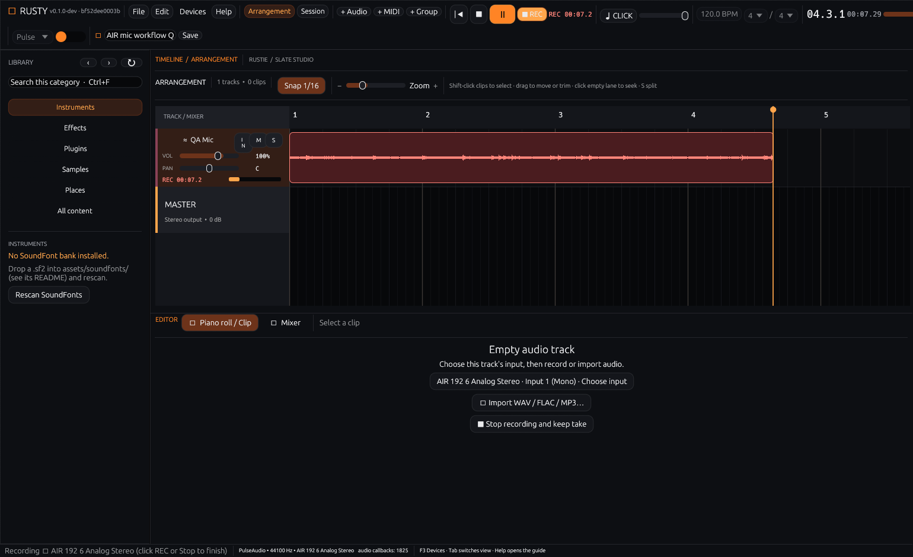
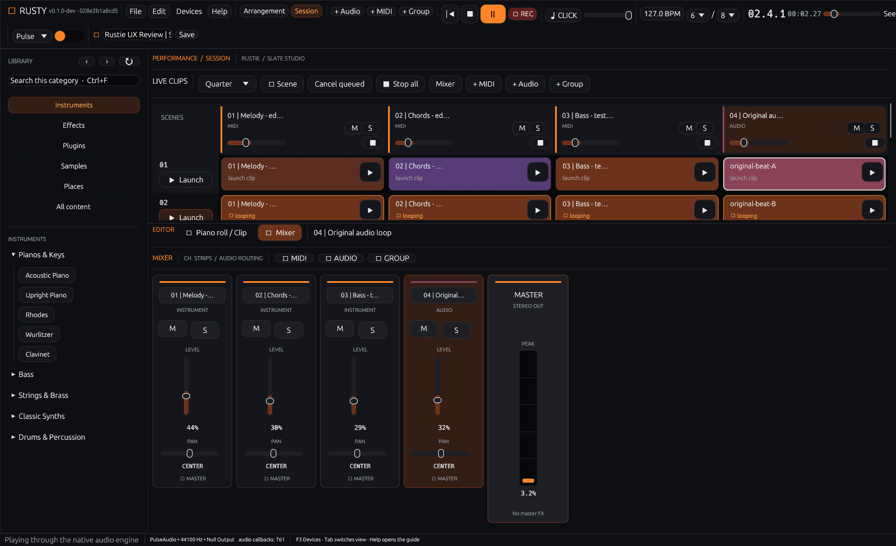

# Rusty — a native Linux DAW, built in the open

**Make music on Linux. Keep the performance yours.**

Rusty is a native Rust/egui digital audio workstation exploring a direct path from recording and clip-based ideas to a saved song. This repository is named **Rustie**; the desktop application is **Rusty**. Earlier documents and project files may say **Slate Studio**. Existing `.slate.json` projects remain part of the compatibility story.

**Development preview · 22 November 2026 · Beta 1 is still NO-GO.** There is functioning native audio, MIDI editing, Session launching, recording, effects and tested CLAP/VST3 hosting. There are also unresolved startup, hardware acceptance, export and distribution gates. This is source and evidence for a developing instrument, not a production release. [Current status](docs/PROJECT_STATUS.md) · [Release decision](docs/BETA1_RELEASE_DECISION.md)



*Actual compiled native application, 22 November mic-workflow candidate. The visible base revision includes uncommitted changes at capture time; see [screenshot provenance](docs/SCREENSHOTS.md). A screenshot demonstrates the UI, not audible quality.*

[Pitch and motivation](docs/PITCH.md) · [How Rusty differs](docs/DIFFERENTIATION.md) · [Screenshot gallery](docs/SCREENSHOTS.md) · [Development story](docs/DEVELOPMENT_STORY.md) · [Roadmap](docs/ROADMAP.md) · [Documentation index](docs/README.md)

## Why this exists

We want a music-making environment that belongs naturally on Linux, makes capture and playback understandable, and can evolve from a musician's actual feedback. The experiment has two parts: build the working DAW foundation, and test whether a performance-preserving vocal workflow can make the whole experience meaningfully better.

That second idea lives in **Autonatural**, a separate experimental offline Lab. It aims to correct the center of a sung note while retaining the movement around it. The render/import pipeline has synthetic evidence; naturalness on real singers remains unproven. It is **not included as a finished feature of the main DAW**. [Autonatural research](docs/AUTONATURAL.md)

## What is working, and where the limits are

| Area | Implemented development capability | Limit / evidence boundary |
|---|---|---|
| Arrangement | Audio/MIDI clips, waveforms, zoom/snap, clip editing, multi-selection and undo/redo | Seek follow-up and current acceptance are tracked in [status](docs/PROJECT_STATUS.md) |
| Session | Independent saved clip slots/scenes, quantized clip and scene launches, stop/cancel, engine-owned loops | Long performances and physical transition quality need broader testing |
| Recording | Physical source selection, WAV capture, track-owned mono/stereo choice, input meter, growing take preview | Latest mic acceptance is tracked separately from owner headphone listening |
| Instruments | Built-in diagnostic sine, local SoundFont presets, hardware MIDI audition and note capture | No third-party SoundFont bank distributed; device coverage is limited |
| Mixing | Track/group routing, gain/pan/mute/solo, metronome, EQ3/EQ8 and two reverbs | Full production mixer, automation and measured PDC remain roadmap work |
| Plug-ins | Isolated live CLAP/VST3 effects/instruments for tested classes; native-state save/reopen; offline rendering | Named compatibility results only; LSP VST3 metadata failure remains open |
| Projects/export | Native JSON save/open, legacy migration, WAV Arrangement export | Enabled live inserts block export; use printed audio and bypass inserts |
| Autonatural | Separate offline Lab: render a new vocal take, align it and compare original/tuned | Research alpha, outside main DAW release gates |

[Detailed feature matrix](docs/FEATURE_MATRIX.md) · [Verification ledger](docs/VERIFICATION.md) · [Known limitations](docs/KNOWN_LIMITATIONS.md)

## See the application



*21 November integrated Session build. The gallery distinguishes this baseline from the 22 November follow-up captures.*

The **Midnight Ember** interface uses graphite surfaces, restrained orange transport/selection accents and contrasting clips. It is implemented in native egui. The repository contains real app captures, not rendered product concepts.

## Build and run

Linux development setup: Rust **1.89 or newer**, a C/C++ toolchain, `pkg-config`, and the ALSA, JACK, PulseAudio, X11/Wayland and OpenGL development libraries required by the selected backends. See [development setup](docs/DEVELOPMENT.md) and the checked-in CI workflow for the Ubuntu package list.

```bash
git clone https://github.com/TheGoldiestGoldy/Rustie.git
cd Rustie
cargo build --locked --release -p daw-ui -p daw-plugin-host
./target/release/daw-ui
# Optional: open directly in Session view
./target/release/daw-ui --session
```

Build the UI and worker together. For a versioned local app-menu installation from a clean committed checkout, run `./scripts/install-rusty-local.sh`. [Installation](docs/RUSTY_DESKTOP_INSTALL.md) · [First session](docs/GETTING_STARTED.md)

```bash
cargo fmt --all -- --check
cargo test --workspace --locked
cargo clippy --workspace --all-targets --locked -- -D warnings
```

## How we develop it

AI coding agents help implement scoped changes. Musical decisions, feedback and acceptance still require a person. We keep source, regression tests, dated reports, build identity and failures visible. A green build is different evidence from a GUI interaction, nonzero PCM, headphone listening or measured analogue latency.

The 21 November integration baseline passed **154 tests**, including **eight realtime allocation guards**, and a **615.816-second virtual recording with zero reported input drops**. Later follow-up results are revision-specific in the [verification ledger](docs/VERIFICATION.md). None of those numbers proves universal plug-in compatibility or production reliability.

## Source map

| Path | Role |
|---|---|
| `crates/daw-core` | Musical time, project models, scales, commands and state |
| `crates/daw-engine` | Render graph, native drivers, audio/MIDI scheduling, capture-adjacent monitoring and DSP |
| `crates/daw-ui` | Native application, recording workflow, editors, browser and project I/O |
| `crates/daw-plugin-host` | Isolated scanning, offline rendering and realtime plug-in worker |
| `crates/daw-parser`, `crates/daw-host-client` | Reserved scaffolding; not proof of completed interchange/IPC APIs |
| `docs/agent-reports` | Dated implementation and verification history |
| `docs/beta-plan` | Release criteria and scoped engineering briefs |

[Architecture](docs/ARCHITECTURE.md) · [Contributing](CONTRIBUTING.md) · [Security](SECURITY.md)

## License and distribution

The repository retains its existing **MIT OR Apache-2.0** license declaration and license texts. Complete contributor-rights confirmation and dependency/distribution notices remain release gates. Installed plug-ins, commercial banks, personal songs and microphone recordings are not included. [License/asset notes](docs/LEGAL_AND_ASSETS.md) · [Dependency register](THIRD_PARTY_NOTICES.md)
