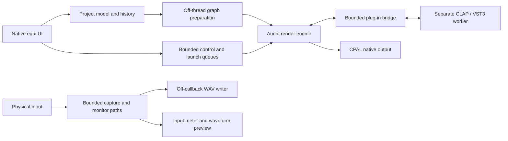

# Architecture

This overview describes the integrated development design. Revision-specific behavior and measurements live in the [verification ledger](VERIFICATION.md) and dated reports.

## Domain and persistence

`daw-core` owns musical time at 960 PPQ, tempo-map conversion, project tracks/clips/notes, scales, commands, plug-in state and instrument settings. JSON project loading preserves legacy `.slate.json` compatibility. Arrangement clips and Session slots have independent ownership. Stable IDs and migration validation protect that distinction. [Session contract](SESSION_ENGINE.md)

## Render engine

`daw-engine` compiles a graph off the audio callback, schedules events against engine/project timing and applies bounded commands. The graph includes audio/MIDI sources, routing, native effects and instrument paths. Realtime allocation guards cover selected render operations, not every instruction inside the operating system, audio backend or external plug-in.

Audio decoding currently loads files into RAM and uses basic offline resampling. Native drivers expose PulseAudio, ALSA and JACK paths; availability and routing depend on the host. Requested buffer sizes and callback timestamps are not analogue round-trip latency measurements.

## Recording

The UI coordinates pinned source selection and a bounded capture queue. WAV writing and preview construction happen outside the realtime callback. The 22 November follow-up adds persisted physical-channel selection, selected-channel metering before recording, capture-driven elapsed time and a growing preview. Monitoring is controlled separately. Raw source levels and existing recordings remain unchanged.

## Plug-in execution

`daw-plugin-host` is the companion process for scanning, offline rendering and live CLAP/VST3 processing. The live bridge uses bounded packets/deadlines and explicit failure behavior. Save/reopen support is verified for named classes, not every plug-in. Worker failure handling does not establish a security boundary. Offline Arrangement export currently guards enabled live inserts.

## UI and integration boundary

`daw-ui` contains the native egui application and `studio_*` modules for Arrangement, Session, piano roll, browser, devices, recording, export and history. The UI and worker are installed as a matched versioned pair. Topology changes and stream recovery still need careful off-thread handling and runtime tests.

`daw-parser` and `daw-host-client` remain reserved scaffolding. The separate Autonatural Lab invokes a pinned offline DSP process; it is not a merged main-DAW subsystem.

## Engineering constraints

Keep disk I/O, allocation, scanning and graph construction out of the callback. Bound queues and preview storage. Preserve source media and old saves. Measure startup, repeated seeks, MIDI state, worker failure, device loss and reopen behavior independently. Publish unsupported cases rather than inferring universal behavior from one successful probe.
