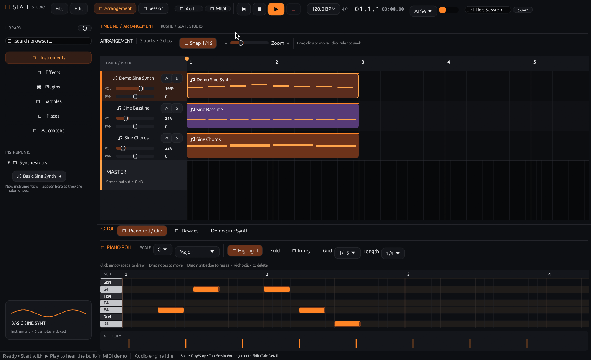
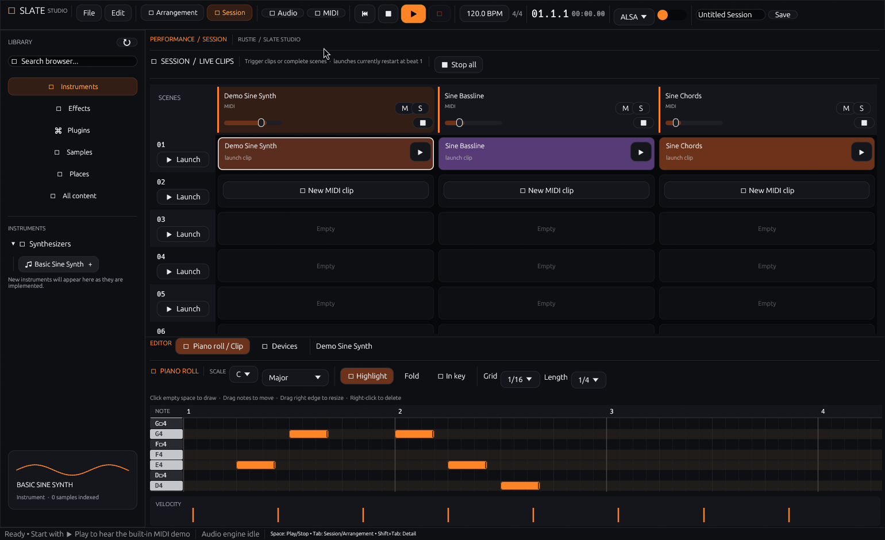

> Historical design/implementation notes. For current capabilities and gates, see [project status](PROJECT_STATUS.md) and [architecture](ARCHITECTURE.md).

# Slate Studio: Midnight Ember UI

Updated: 2026-11-17. Status: implemented, test-built visual redesign.

## Design intent

Midnight Ember is the original Rustie/Slate Studio interface direction inspired by a black-and-orange DAW concept. It emphasizes graphite panels, matte-black canvas, warm orange active states, purple secondary clips, restrained borders, compact controls and clear musical editing affordances.

This is **implemented native egui drawing**, not an HTML page or a bitmap masquerading as a DAW. The rendering is not an exact reproduction of the reference concept. There is **no real backdrop blur, GPU bloom, glass refraction, custom icon font, animated fake audio meter, or bundled proprietary asset**.

## Verified screenshots

These are actual 1540 × 940 captures of the compiled Linux application using the built-in three-track MIDI starter song.

## Palette (RGB)

| Token | Value | Purpose |
| --- | --- | --- |
| INK_0 | 7,8,10 | Canvas / extreme black |
| INK_1 | 13,15,19 | Side and transport panels |
| INK_2 | 20,22,27 | Raised surfaces |
| INK_3 | 29,31,37 | Control and master surfaces |
| STUDIO_BORDER | 45,47,53 | Quiet separators |
| STUDIO_TEXT | 234,235,237 | Primary typography |
| STUDIO_DIM | 152,155,162 | Secondary typography |
| ACCENT | 255,132,37 | Transport and MIDI notes |
| ACCENT_BRIGHT | 255,165,75 | Bright highlights and playhead |
| ACCENT_DARK | 109,51,26 | Orange selection fills |
| ACCENT_TINT | 51,30,22 | Active section backgrounds |
| CLIP_PURPLE | 87,59,119 | Secondary MIDI channel |
| CLIP_PINK | 138,66,87 | Audio/session contrast |

Authoritative global palette: `crates/daw-ui/src/theme.rs`. Surface-specific colors are in `studio_views.rs`, `studio_session.rs` and `studio_piano.rs`.

## Implemented UI

- **Transport:** compact responsive top toolbar containing functional play, pause, stop, return-to-start, tempo, beat/time readouts, audio-backend chooser, project name and save controls. Audio record affordance is explicitly disabled until recording is built. Master bar uses the engine's actual peak telemetry; it is not a pretend CPU meter.
- **Browser:** full-height sidebar with Instruments, Effects, Plugins, Samples, Places and All content, actual search, directory indexing, a real built-in sine synth action, sample import and a simple mathematically rendered sine-wave preview. Installed plugins are discoverable but disabled because they cannot be loaded yet.
- **Arrangement:** near-black beat grid, orange playhead, color-coded MIDI/audio regions, original thin clip borders, volume/pan/mute/solo, clip selection and dragging, zoom and snap. Drawing extends through the available editor region.
- **Piano roll:** scale root/mode, highlighted in-scale/root notes, in-scale lock, fold, snapping and note length; click to add/select, drag to move, edge-drag to resize, right-click or Delete to remove, duplicate and editable velocity. Black/white note keys, corrected MIDI octave names (60 = C4), pinned bar-number ruler, and a velocity visualization.
- **Session:** responsive clip grid with full scene launch, individual launch, stop track, stop all and add MIDI/audio slots. Selected/active clips have distinct accents, with progress bars based on actual transport frames.
- **Starter arrangement:** three **real**, playable built-in sine instrument tracks (melody, bassline, chords), not image-only mock data.
- **Window:** 1540 × 940 default, resizable down to 980 × 640. Sidebar and detail editor are resizable.

## Interaction shortcuts

Space toggles transport; Tab switches Arrangement/Session; Shift+Tab changes Clip/Devices; Ctrl+F browser search; Ctrl+S save; Ctrl+O open. Use `./target/release/daw-ui --session` to open directly in the Session view.

## Round 2 interaction update (2026-11-17)

A distinct Mixer tab now appears in the bottom editor and is selected on entering Session, with readable track and group strips. Track names in both views have shared right-click commands for rename, create, group into an actual bus, move to/from a group, and delete with confirmation. Grouped tracks are visually indented. Piano, Arrangement and Session canvases allow explicit scrollbar/wheel navigation but no longer drag-pan the content alongside note/clip gestures. The user must retest the intermittent rightward creep. Details: `docs/UX_REVIEW_ROUND2.md`.

## Round 3 visual feedback response (2026-11-18)

User-supplied video revealed the left Library width expanding without deliberate drag, shifting the workspace right during stopped transport. The Library is now fixed to an explicit controlled width with ‹/› deliberate resize buttons; nested browser content has a max-width cap. Both arrangement tracks (clips and blank lane) and Session slots now receive track-specific context menus. The old overcrowded horizontal Mixer panel was rebuilt as tall vertical channel strips and faders, separate M/S and pan, and real master peak meter. These are implemented code changes, not a confirmed new screenshot. Detailed retest: `docs/UX_REVIEW_ROUND3.md`.

## Known limitations

- The generated concept was a visual target. Fine-grained icons, waveform-rich demos, true glass, animated GPU effects, extensive built-in instruments and advanced plugin workflows were **not** implemented by this UI pass.
- Live Session clip/scene launches now queue at a future bar boundary and use 128-frame fades; this is source/test-verified but not yet a measured glitch-free live performance. View changes still rebuild playback.
- Live recording, actual CLAP/VST3 plugin hosting, warping, hardware MIDI, full undo/UI history and production metering are not available.
- The velocity lane visualizes event velocity; editing is through the selected-note slider, not by dragging individual velocity bars.
- Session scene index is currently based on each track's clip position, not a separate serialized clip-slot object.
- Unit tests, strict Clippy and release builds were verified. The UI was launched and visually inspected through actual window captures. Interactive audio I/O, click-through QA on all controls and external output latency were **not** verified in this pass.

## Developer handoff

1. Build: `cargo fmt --all && cargo test --workspace && cargo clippy --workspace --all-targets -- -D warnings && cargo build --release -p daw-ui`.
2. Run: `./target/release/daw-ui` (Arrangement), or `./target/release/daw-ui --session` (Session).
3. Use `theme.rs` for base styling. The respective `studio_*.rs` files draw app surfaces and handle interactions.
4. Inspect screenshots, measure behavior on smaller window sizes and do not regress the working native audio path to achieve decorative effects.
5. Future design steps: custom vector icons, smarter responsive transport overflow, automated UI interaction tests, authentic visual waveform rendering and optional GPU blur.
