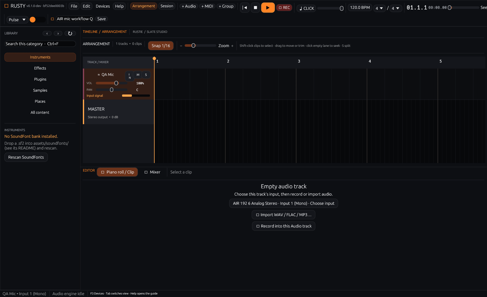
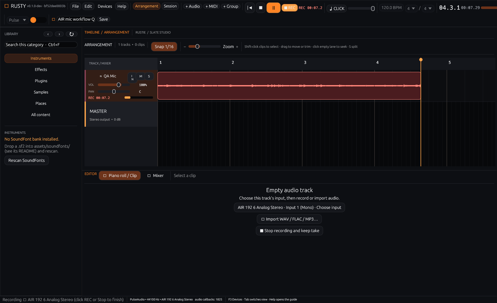
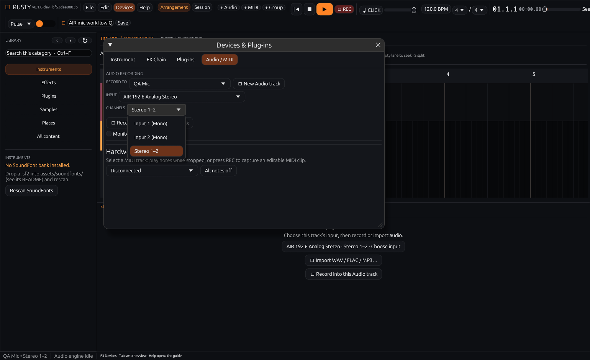
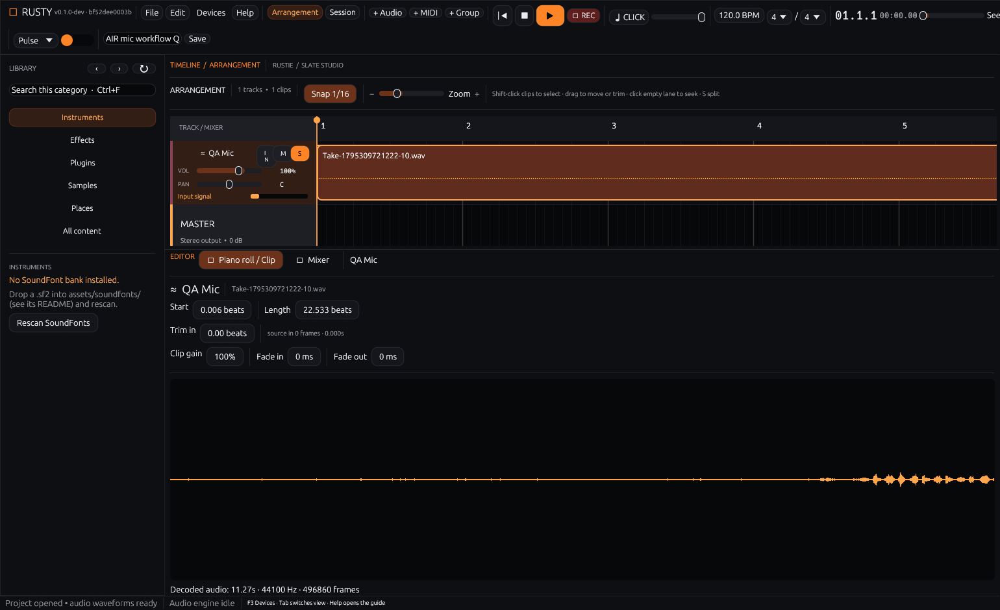
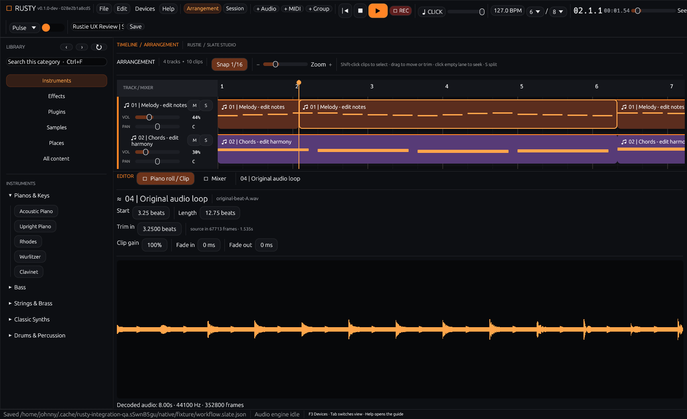
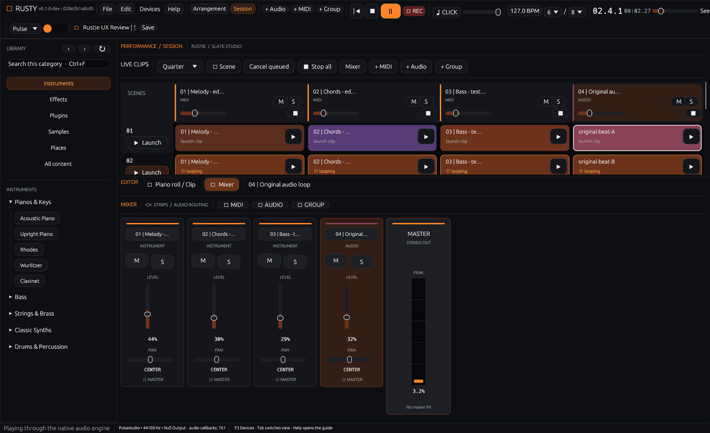
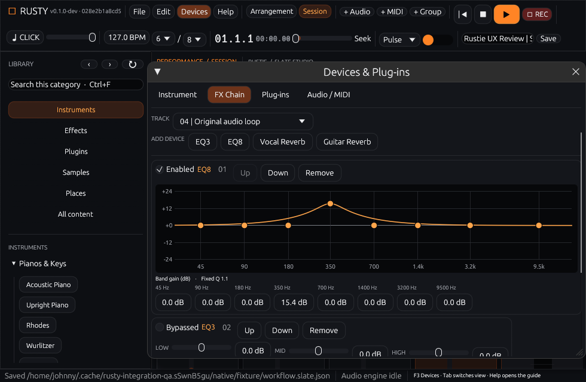
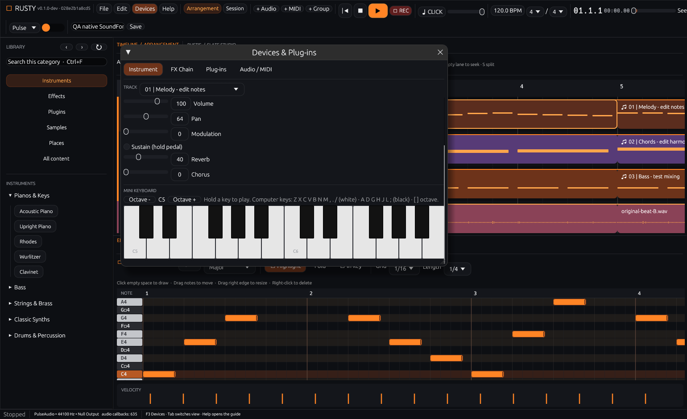
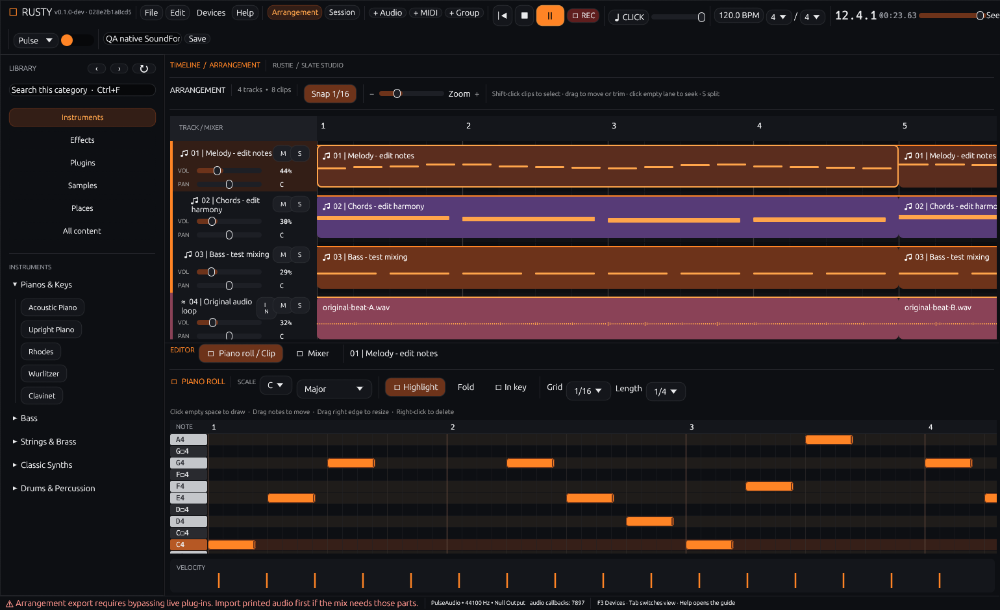

# Actual application screenshots

These are captures of compiled native Rusty windows. No generated concept art is presented as working UI. Images demonstrate appearance and visible state, not audio quality, measured latency or interaction correctness.

## 22 November: microphone workflow candidate

The mic agent captured these in a native GUI acceptance run against base `bf52dee0003b` plus its working-tree mic changes. The title's base SHA alone does **not** reproduce that candidate. These captures predate the final combined mic/seek snapshot and are labeled accordingly. The QA media itself is not published.

### Input signal before recording

### During capture

### Physical channel selection

### Saved take reopened

## 21 November: integrated baseline

These are native integration captures associated with source `028e2b1a8cd530af99fcc5e0910a930b075e1167`, before the 22 November recording/seek follow-ups. See the [baseline report](agent-reports/2026-11-21-beta-integration-followup-report.md).

### Arrangement and editing

### Session and mixer

### Compact native effects

### SoundFont instrument controls

### Explicit export limitation

## Historical visuals

The `midnight-ember-*` captures date to the 17 November UI phase; `showcase/*2026-11-19.png` captures date to 19 November. They are retained for history, not used as proof of current feature completion. Original dimensions and pixels are retained; no decorative UI was painted into these captures.
