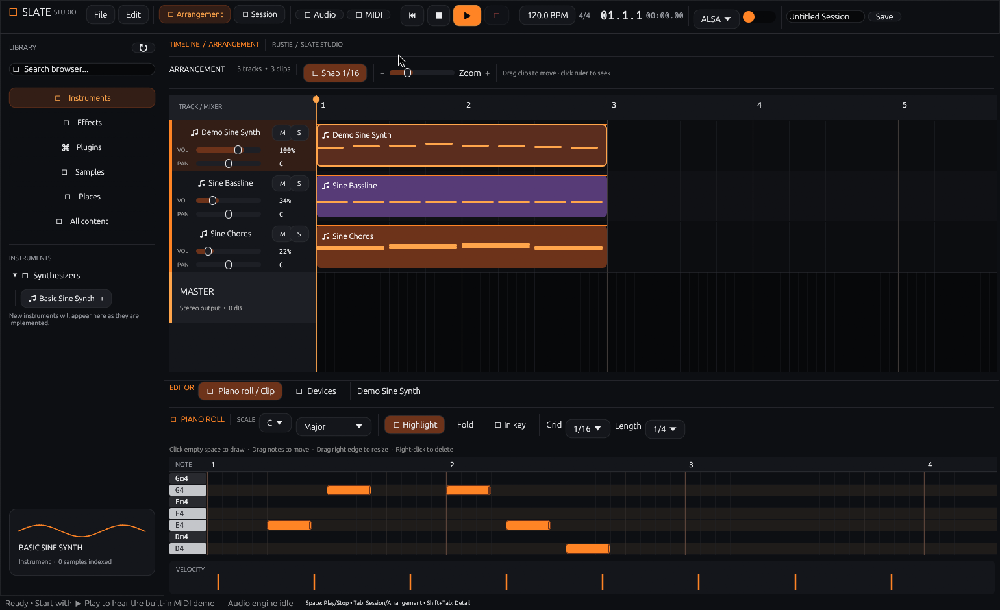
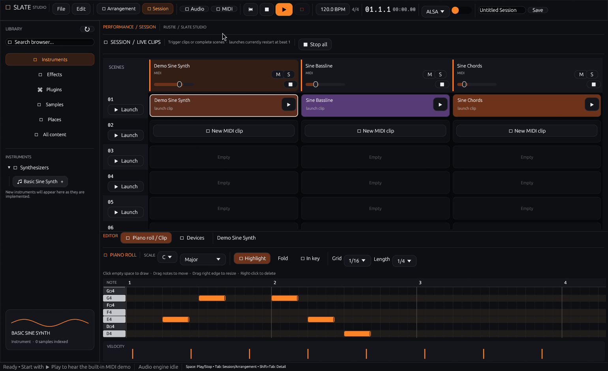

# Rusty | Native Linux Digital Audio Workstation

**Desktop app: Rusty.** A native Linux Rust DAW in progress, targeting CachyOS/Arch, PipeWire/JACK, PulseAudio and ALSA, with zero Wine dependency. The installed GUI shows its exact version and source commit in the window title and top transport bar. Launch the current integrated build from the **Rusty** app-menu entry, not the old Slate Studio shortcut; see [desktop installation and verification](../RUSTY_DESKTOP_INSTALL.md). Existing `.slate.json` files remain readable.

**Beta 1 remains NO-GO.** The integrated development source passes 154 workspace tests. The current release decision records the PulseAudio startup failures, the virtual and native-app evidence, and the remaining hardware and packaging gates. [Release decision](../BETA1_RELEASE_DECISION.md) · [21 November change log](../CHANGELOG_2026-11-21.md).

**Beta 1 status (21 November 2026) · NO-GO.** Wave 1 and Wave 2 are integrated on `beta/integration`. The current development build has independent persistent Session scenes, quantized clip launches, compact Devices with native effects and isolated realtime CLAP/VST3 effects and instruments for the tested plug-ins. The 128-test Cargo gate passed. Arrangement WAV export omits live plug-in processing. Physical audio, microphone alignment and release packaging still need acceptance. [Release decision](../BETA1_RELEASE_DECISION.md) · [Integration verification](../agent-reports/2026-11-21-beta-integration-report.md)

## Crate workspace

- `crates/daw-core`: 960 PPQ music time and tempo map, twelve scales, piano-roll fold math, project data models, command-based undo/redo.
- `crates/daw-engine`: working offline mixer/transport, native CPAL JACK/PulseAudio/ALSA output driver, lock-free SPSC commands, sample-accurate timed events, linear gain ramps, audio clip decoding, graph routing, latency compensation buffers, 16-voice diagnostic MIDI synth and real-time scheduling negotiation.
- `crates/daw-parser`: reserved for native project and .als interchange.
- `crates/daw-plugin-host`: isolated plug-in scan, render, realtime and native-state worker.
- `crates/daw-host-client`: reserved for IPC and plugin lifecycle.
- `crates/daw-ui`: native egui desktop GUI with integrated arrangement, Session overview, drag-to-move clips, piano roll, track mixer controls, media import and JSON project files.

## Midnight Ember UI redesign (17 November 2026)

Slate Studio now uses an original near-black graphite-and-orange visual system with a compact responsive transport, full-height browser, updated color-coded arrangement clips, scale-aware piano roll, pinned musical bar ruler, velocity overview and a responsive Session clip launcher. The three starter tracks are real MIDI patterns routed to the built-in sine synth. The actual release executable was visually inspected on Linux at 1540 × 940.





**Design and implementation documentation:** [Midnight Ember UI](../LIQUID_UI_DESIGN.md). Source files include `theme.rs`, `studio_views.rs`, `studio_browser.rs`, `studio_piano.rs` and `studio_session.rs`. Launch with `./scripts/start-slate-studio.sh` or `./target/release/daw-ui`; optional `--session` opens the Session grid directly.

The 17 November images above are historical. See the integration report for the current build and for the tested CLAP/VST3 classes, supported Session workflow and audio measurements.

For the 17 November source-verified professional-readiness audit, see [DAW readiness audit](../DAW_READINESS_AUDIT_2026-11-17.md). For a precise feature matrix, interaction instructions, licensing cautions, source change history, roadmap and GitHub handoff, see `docs/FEATURE_MATRIX.md`, `docs/GETTING_STARTED.md`, `docs/LEGAL_REVIEW.md`, `docs/CHANGELOG_2026-11-17.md` and `docs/GITHUB_RELEASE_CHECKLIST.md`.

**Instructions for development agents:** Read [`AGENTS.md`](../../AGENTS.md), then finish with a dated progress report using [`docs/AGENT_REPORT_TEMPLATE.md`](../AGENT_REPORT_TEMPLATE.md). Every agent must document changes, verified tests, remaining work, Git status and the next-agent handoff.

**UX review Round 3, video-confirmed:** The left Library pane was growing and shifting the full workspace right. Its width is now explicitly controlled (‹ / › in Library), rather than content-measured, and the actual clip/track lanes have track-specific right-click menus. The lower Mixer is now arranged as upright strips with vertical volume faders. [Round 3 checklist](../UX_REVIEW_ROUND3.md).

**Reviewer feedback implementation (Round 2):** real group mixer buses and saved memberships, track creation/renaming/group management with right-click menus, a Session Mixer tab, and editing canvases with drag-to-pan disabled. Follow [Round 2 test plan](../UX_REVIEW_ROUND2.md) without changing the existing review test project.

**Reviewer build (safe test song and UX checklist):** open **Rustie UX Review** from the desktop application menu, or run `./scripts/start-ux-review.sh`. This creates/preserves a separate four-track/two-scene test project under `~/Music/Rustie UX Review/`, with two original WAV test loops. Review instructions: [UX Review Protocol](../UX_REVIEW_PROTOCOL.md). CLI `--project PATH` loads an existing project directly, and `--check-project PATH` verifies the JSON and audio source references without opening the sound device.

## Current beta audio devices and plug-ins (20 November 2026)

**Development build features:** Metronome with a compact saved volume slider; real microphone WAV recording into the selected Audio track; original EQ3, EQ8 (draggable graph), Vocal Reverb and Guitar Reverb insert chains; redesigned compact Devices tabs; isolated live CLAP and VST3 **audio effects** plus offline VST2/VST3/CLAP clip rendering. Open `Devices` near File/Edit, use **FX CHAIN** to add and reorder effects, **PLUG-INS** to choose a bundle and insert a live audio effect on an Audio track/group, and **AUDIO / MIDI** to select the recording interface. Press REC on an Audio track to capture a WAV, REC again/Stop to finalize.

The tested effects are LSP Limiter Stereo CLAP and Surge XT Effects VST3. The tested external instrument is Surge XT in CLAP and VST3. Explicit Save captures supported state and records the worker's VST3 class. The installed LSP VST3 bundle fails class metadata inspection. To export an Arrangement that uses live inserts, import printed audio for those parts and bypass the inserts before choosing File → Export Arrangement to WAV. [Current compatibility and fault results](../agent-reports/2026-11-21-beta-integration-followup-report.md).

## Live MIDI keyboard audition (19 November 2026)

In **Devices → Audio / MIDI**, choose a physical MIDI input for the selected MIDI track. The app can audition while stopped and record editable note takes. Supported external instruments receive sustain and pitch bend. In **Devices → Instrument**, select a local General MIDI SoundFont bank and preset. The mouse keyboard and computer keys work while the Instrument tab is open. Tracks without an assigned SoundFont continue using the sine instrument.

Safe no-capture diagnostic: `target/release/daw-ui --probe-midi 'AIR 192 6'` lists and opens/closes the corresponding MIDI port. The live MIDI code and audio engine monitoring test passed and the physical AIR 192|6 port connected, but keyboard-to-speaker sound and GUI operation need a human test. Fully close any older Rustie instance before reopening the newly compiled binary. [Detailed verified report](../agent-reports/2026-11-19-live-midi-input.md).

## Beta functionality added on 19 November 2026

The transport now has a real optional **♩ CLICK** metronome that accents beat one at the project tempo/time signature. The native **Devices** window is organized into small **FX CHAIN**, **PLUG-INS**, and **AUDIO / MIDI** tabs. Add, bypass, reorder and configure real original-code **EQ3**, **EQ8**, **Vocal Reverb**, and **Guitar Reverb** effects per track or group. EQ8 offers a draggable eight-point frequency-response graph based on its real biquad coefficients. Settings are saved in the project; older projects load with empty effects and metronome off.

**Hardware recording:** select an audio track and press REC; the physical AIR 192|6 input and bounded WAV capture queue were successfully probed at 44.1 kHz, 15038 frames captured and zero reported drops. Enable the optional "Direct monitor input through Rustie" in Devices > Audio/MIDI only when needed; turn off your interface's hardware direct monitor or expect doubled sound/feedback. Real ear-level latency, take alignment and quality still need checking. Output playback-monitor sources are excluded from microphone choices to prevent accidental desktop-audio recording.

**Third-party plugins:** there is now a real **isolated, offline CLAP** instrument/effect renderer alongside existing VST2/VST3 offline support, with per-bundle CLAP class scanning. A synthetic CLAP Surge XT MIDI clip and an LSP Stereo Limiter effect both rendered to verified non-silent stereo WAV files. Choose a clip and use Devices > PLUG-INS, select a native plugin and, for CLAP, scan and choose its class. This produces a new WAV track, not a live, stateful plugin instance. **Realtime CLAP/VST3 track inserts, GUI embedding, preset/state recall and low-latency plugin audition remain unfinished**, and so this is not yet a complete beta.

Source/test/reproduction details: 19 November verified agent report (historical reference; file unavailable in supplied checkout). Close the older running application and relaunch `target/release/daw-ui` for the new controls.


**Further input-clock root-cause correction:** CPAL's default PulseAudio capture buffering was reporting ~1010 ms input latency and captured ~1s of audio during a nominal 350ms test. Changed PulseAudio input requests to a 512-frame fixed buffer and added a stream-ready plus capture-timestamp gate, keeping stale pre-roll out of WAV takes. Verified three additional 350ms tests on the real AIR 192|6 input: **339, 342, 342 ms recorded**, opening **5-6 ms**, **0 dropped queue frames**; no temp audio retained. This measures file/callback alignment only, not real analogue input-to-speaker round-trip latency.

## Latest local output-clock and timeline verification (18 November 2026)

At startup the PulseAudio GUI now queries the **selected output sink's actual sample rate** instead of relying on another device's capture rate. This matters on the current USB interface: a silent transport probe at 44.1 kHz progressed normally, while forcing 48 kHz produced only one callback and stalled. The UI can now seek with a left click in an **empty arrangement track lane**, as well as the ruler; clicking an audio/MIDI clip still selects the clip. Four targeted clock/seek regressions were added. All 59 workspace tests, strict Clippy, formatting and release build passed. The native app was smoke-launched for six seconds; manual mouse interaction, hardware-recording and speaker-onset latency remain unverified. See [the agent report](../agent-reports/2026-11-18-output-clock-and-timeline-seek.md).

## Tests

```bash
cd ~/Projects/rust-daw
cargo test --workspace
cargo clippy --workspace --all-targets -- -D warnings
cargo fmt --all -- --check
```

## Inspect audio devices (no sound)

```bash
cargo run -p daw-engine --bin daw-audio-probe
```

## Native audio output diagnostics

the initial Linux test workstation currently runs **PulseAudio for hardware sinks** and a separate PipeWire/JACK graph without any sound sinks. The original JACK test successfully rendered audio but was not routed to physical playback. This is why the output remained silent.

The diagnostic and GUI now prefer **ALSA through the system's default device** for more consistent real-time pacing on the initial Linux test workstation. PulseAudio remains available. You can explicitly choose any backend with the third argument `pulse`, `alsa` or `jack`:

```bash
# Silence; opens a real output stream for two seconds
cargo run -p daw-engine --bin daw-audio-probe -- --silent 48000 pulse

# Short, low-volume 440 Hz audible test, explicitly requested by the user
cargo run -p daw-engine --bin daw-audio-probe -- --tone 48000 pulse

# JACK test requires actual connected JACK/PipeWire output ports
PIPEWIRE_LATENCY=128/48000 cargo run -p daw-engine --bin daw-audio-probe -- --silent 48000 jack
```

**Important device profile:** On 2026-11-16 PulseAudio's M-Audio AIR 192|6 sink was `Digital Stereo (IEC958)`, not the analog headphone/monitor output. If listening through the AIR's analog outputs, first choose **Analog Stereo Duplex** in `pavucontrol` → Configuration (preserves the analog recording input), or run:

```bash
pactl set-card-profile alsa_card.usb-M-Audio_AIR_192_6-00 output:analog-stereo+input:analog-stereo
```

This changes the system audio profile, so do it **only when ongoing recordings, calls or music are stopped**. The agent deliberately left the existing profile unchanged because Vesktop had an active audio stream. If using actual optical/SPDIF output instead, do not change the card profile.

The new probe reports the peak sample amplitude of audio generated by the DAW. `Peak generated output` above zero proves the DSP engine made sound, *not* that it reached speakers. The test tone produced a peak of 0.045 (−26.9 dBFS) on native PulseAudio at 48 kHz. A PulseAudio backend may prebuffer more than the wall-clock duration; displayed frame counts do not prove physical output latency. XRuns and round-trip latency remain uninstrumented.

In previous testing, JACK at 48 kHz accepted `PIPEWIRE_LATENCY=128/48000`, processed approximately 750 callbacks over two seconds, and did not modify the global PipeWire 1024-frame quantum.

## Current constraints

- Graph topology, audio buffers, MIDI voices, and plugins MUST be created or loaded off the real-time audio thread. No structural graph replacement while a stream is playing.
- Gain/route changes and MIDI events are scheduled with absolute engine-frame timestamps, independent of musical playback location. Out-of-order commands are sorted into fixed-capacity storage.
- PDC is computed from each node's *declared* latency. There are no hosted plugins yet, so actual plugin latency reporting and time-varying latency are not yet tested.
- Decoder loads files into RAM and does only basic linear sample-rate conversion offline. Professional-quality sample rate conversion and long-file disk streaming are future work. Multichannel audio currently reads the first two channels.
- Native JACK output requires connected PipeWire/JACK sinks. The **GUI currently defaults to PulseAudio** and reads the selected output sink's rate before playback; the lower-level engine DriverConfig defaults to ALSA. Even a nonzero rendered peak does not prove that external speakers are connected.
- ALSA callback scheduling requests SCHED_FIFO via existing permissions and falls back to RTKit D-Bus; JACK scheduling is managed by PipeWire. Neither method should run from inside the audio-render callback.
- The no-allocation integration tests guard **our audio-processing code**, not every instruction executed inside CPAL/JACK/ALSA.
- There is no professional metering, measurement of xruns, real-time watchdog, hardware MIDI I/O, multitrack recording, plugin sandbox or production-quality GUI workflow yet.

See `docs/ARCHITECTURE.md` for design notes and remaining milestones. No proprietary Ableton assets, binaries, or branding are embedded.
